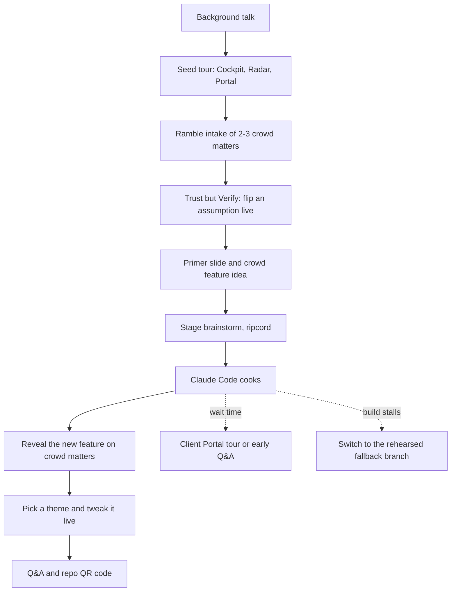

# Matter Cockpit CLE Vibe-Coding Demo - Plan

## Goal Capsule

- **Objective:** At a 45-minute Minnesota CLE in December 2026, lawyers from every practice area in the room watch Damien build a real, beautiful legal app feature live from their own ideas, see it work on matters from their own practice, and leave able to point Claude Code at the same free repo and do it themselves.
- **Means:** A purpose-built, open-source stage kit (Matter Cockpit) prepared like a cooking show, with a clean main branch for the live build and pre-built fallback branches.
- **Product authority:** Damien decides product direction, visual taste, and run of show; technical choices follow engineering best practice.
- **Open blockers:** None. Visual direction is settled by a prep sketch session (R31), not before planning.

---

## Product Contract

### Summary

Matter Cockpit is a small, open-source web app with three views over one shared set of legal matters: Cockpit (one matter in depth), Deadline Radar (every deadline on one wall), and Client Portal (what the client sees). Damien adds matters on stage by rambling into an intake box, and a Trust but Verify panel shows the rule text, date math, and reasoning behind every deadline. Then the room proposes a feature, a compressed brainstorm scopes it, and Claude Code builds it live in about ten minutes.

### Problem Frame

Most lawyers have heard that "anyone can build software with AI" and assume it does not apply to them. A CLE room mixes litigators, transactional lawyers, patent prosecutors, bankruptcy lawyers, family lawyers, employment lawyers, and regulatory lawyers, so a demo built around one practice area loses most of the audience. The session runs 45 minutes, and background and Q&A take most of it, which leaves roughly ten minutes of build time.

The existing open-source legal AI platforms (Mike, BigLaw, LQ.AI) are large, multi-service codebases. On those, Claude Code spends minutes reading before it writes, and a multi-container stack adds live-failure risk. A CLE audience also expects professional skepticism: a demo that shows AI output without showing its sources would undercut the ethics message.

### Key Decisions

- **Purpose-built stage kit, with an ecosystem slide.** A small codebase lets Claude Code build in minutes, and the slide credits Mike, BigLaw, and LQ.AI as repos attendees can explore afterward. (session-settled: user-approved — chosen over building on Mike, BigLaw, or LQ.AI directly: their size and multi-service stacks slow and endanger a ten-minute live build.) Governs R36.
- **Three views over one matter set.** Every view reads the same matters, so a matter entered once appears everywhere. (session-settled: user-directed — chosen over a single Matter Cockpit view: Damien added Deadline Radar and Client Portal.) Governs R1–R4.
- **Damien does all input.** No attendee phones and no hosted submission backend. (session-settled: user-directed — chosen over live QR intake: Damien types or dictates every crowd matter.) Governs R7.
- **Two intake channels: the app's Ramble box for matters, Claude Code for features.** Claude Code also serves as the intake fallback. (session-settled: user-directed — chosen over app-only or Claude-Code-only structuring.) Governs R7, R14, R23.
- **The AI picks the rule; code does the math; rule text comes from a bundled library.** Invented rule text or arithmetic on a projector in front of lawyers would sink the demo. (session-settled: user-approved — chosen over AI-written rule text: broader coverage, but a real risk of invented rule text on screen.) Governs R16–R21, R38.
- **Source labels on every field.** Distinguishing "you said" from "AI invented" makes the hallucination lesson visible. (session-settled: user-approved — chosen over unlabeled fields.) Governs R12.
- **Compressed, ripcord-able stage brainstorm.** The full brainstorm-plan-build cycle cannot fit in ten minutes, so the stage version asks questions until Damien pulls the ripcord. (session-settled: user-directed — Damien proposed the ripcord variant.) Governs R23–R26.
- **Design comes last.** Theme choice and live tweaks close the demo, after the substantive parts. (session-settled: user-directed — chosen over opening with a quick theme tweak.) Governs R33.
- **Cooking-show fallbacks live on branches, never on main.** Main stays clean so the live build is real. Governs R28, R29.

### Actors

- A1. Damien: presenter and the only person who types or dictates, driving Claude Code through Remote Control in Chrome and using his Chrome dictation app for voice.
- A2. The audience: CLE attendees who call out matters and feature ideas and vote on themes.
- A3. The app's intake AI: structures rambles, asks follow-ups, embellishes, picks rules, and writes reasoning.
- A4. Claude Code: runs the stage brainstorm, builds features and theme tweaks, and serves as the intake fallback.
- A5. Attendees after the session: clone the repo and point their own Claude Code at it.

### Requirements

**Views and shared data**

- R1. All views read and write one shared set of matters, and a new or changed matter appears in every view without a reload.
- R2. Cockpit shows one matter in depth: parties, practice area, court or forum, timeline of events, documents, and deadlines.
- R3. Deadline Radar shows every matter's deadlines on one visual wall, ordered by urgency, with countdowns and practice-area color coding.
- R4. Client Portal shows a client-facing view of a matter in plain language: status, next steps, upcoming dates, and shared documents.
- R5. The app ships with seven seed matters, one each for litigation, transactional, patent prosecution, bankruptcy, family, employment, and regulatory practice, set in Minnesota or federal forums where a forum applies.
- R6. Seed matter dates are anchored relative to the current date, so the Radar always shows upcoming deadlines rather than lapsed ones.

**Ramble intake**

- R7. A Ramble box accepts free-form, stream-of-consciousness text typed or dictated by Damien and turns it into a structured matter.
- R8. After a ramble, the app asks at most three targeted follow-up questions about facts it needs, chiefly deadline triggers such as a service date or a petition date.
- R9. Embellish is available at every intake step and fills every remaining field with detailed synthetic data consistent with what Damien has said.
- R10. Surprise Me builds a complete synthetic matter from nothing, optionally limited to a practice area Damien picks.
- R11. The matter builds on screen progressively as the AI extracts it, then lands in all three views with a visible arrival animation.
- R12. Every field carries a visible source label distinguishing what Damien stated from what the AI inferred or invented, and a toggle highlights only the stated facts.
- R13. Every matter, seed or crowd-entered, is plainly synthetic, and the app never asks for or stores real client information.
- R14. Damien can add a matter through Claude Code instead of the Ramble box, and the result matches a Ramble-created matter.

**Trust but Verify**

- R15. Selecting any deadline or AI-derived fact opens a Trust but Verify panel that shows its work.
- R16. The panel shows the governing rule's verbatim text from the bundled library, with a link to its official source.
- R17. The panel shows the date math as ordered steps: trigger date, period added, landing day, any weekend or holiday roll-forward with its rule, and the final due date.
- R18. The AI chooses the governing rule and trigger, and deterministic code computes every date.
- R19. The panel lists each assumption behind a deadline as a toggle, and flipping one recomputes the deadline and redraws the math live; for example, switching personal service to mail service adds three days under Fed. R. Civ. P. 6(d).
- R20. The panel shows a plain-English reasoning chain for why the rule applies, with the same stated-versus-inferred labels as R12.
- R21. When no bundled rule matches, or the rule has no computed-deadline logic, the panel shows the reasoning and an amber "No source on file. Verify independently." warning instead of a date.

**Rules library**

- R22. The library bundles verbatim text of all the Federal Rules of Civil Procedure, all the Minnesota Rules of Civil Procedure, and all the Minnesota General Rules of Practice, plus the targeted sections the seed matters rely on (such as Fed. R. Bankr. P. 3002(c), 37 C.F.R. 1.134 and 1.136, 42 U.S.C. § 2000e-5(e)(1), and the APA comment-period provisions), each with a link to its official source.
- R38. About 25 deadline rules carry computed-deadline logic, covering every seed matter's deadlines.

**Stage brainstorm**

- R23. A single stage command starts a compressed brainstorm on the crowd's feature idea inside Claude Code, asking one question at a time with a recommended answer attached.
- R24. Damien answers as many questions as time allows, and the ripcord phrase "answer everything else yourself" makes Claude Code decide every remaining question on its recommendations and start building immediately.
- R25. The stage brainstorm carries a built-in time budget, so it pulls the ripcord itself when the budget runs out.
- R26. The stage brainstorm shrinks oversized ideas to a slice that looks finished within the build budget, and states the shrink out loud.
- R27. A primer slide shows six example feature ideas, and the room may propose any idea, rehearsed or not.
- R28. Each of the six example ideas has a rehearsed, known-good implementation on its own fallback branch.
- R29. The main branch carries none of the six features, so any live build is genuinely new work.

**Visual design and themes**

- R30. The app looks like a premium legal product, modern and elegant, and stays legible from the back row on a washed-out venue projector.
- R31. In prep, Damien and Claude sketch rough visual options together to settle three distinct, finished visual directions grounded in UX and UI best practice.
- R32. The three directions ship as themes the audience can switch between live, and each covers all three views and the Trust but Verify panel.
- R33. At the end of the demo, the audience picks a theme and calls out tweaks, and Damien has Claude Code apply them live in about a minute each.

**Stage operation and attendee takeaway**

- R34. Damien drives everything from Chrome via Remote Control, and the running app is viewable in a presentation browser that shows each change Claude Code makes without a manual restart.
- R35. A full rehearsed run is recorded as a last-resort backup video.
- R36. The repo is public and free, and its README tells attendees how to run it and point Claude Code at it, assuming they have Claude Code and an API key.
- R37. Without an API key, the app still runs with the seed matters, Trust but Verify, and Surprise Me drawn from a canned pool, and it explains plainly what the key unlocks.

### Key Flows

- F1. Ramble intake
  - **Trigger:** An attendee calls out a matter and Damien starts dictating.
  - **Actors:** A1, A2, A3
  - **Steps:** Damien rambles; the matter builds progressively; the app asks up to three follow-ups; Damien answers some, gets an answer from the room, or presses Embellish; the matter lands in all three views.
  - **Covered by:** R7–R12
- F2. Verify a deadline
  - **Trigger:** Damien selects a deadline on the Radar or Cockpit.
  - **Actors:** A1, A3
  - **Steps:** The panel opens with rule text, date-math steps, assumptions, and reasoning; Damien flips an assumption; the date and math redraw.
  - **Covered by:** R15–R21
- F3. Crowd feature build
  - **Trigger:** The room proposes a feature after seeing the primer slide.
  - **Actors:** A1, A2, A4
  - **Steps:** Damien runs the stage command and dictates the idea; Claude Code asks questions with recommended answers; Damien relays the room's answers until time runs short; Damien pulls the ripcord or the budget does; Claude Code builds; the feature appears in the running app on the room's matters.
  - **Covered by:** R23–R29, R34
- F4. Stage run of show (the build phase fills its wait time)

### Acceptance Examples

- AE1. **Covers R8, R9.** **Given** Damien rambles about a fired employee but never says when, **when** the app asks "When was the termination?" and Damien presses Embellish, **then** the app fills a plausible termination date labeled invented and computes the EEOC charge deadline from it.
- AE2. **Covers R18, R19.** **Given** a federal complaint served personally with an answer due on a weekday, **when** Damien flips the service assumption to mail, **then** the due date moves three days later, rolling to the next business day if needed, and the math steps show Rule 6(d) and any Rule 6(a)(1)(C) roll-forward.
- AE3. **Covers R21.** **Given** a regulatory matter whose AI-chosen authority has no computed-deadline logic, **when** Damien opens its deadline, **then** the panel shows the reasoning and the amber no-source warning instead of a date.
- AE4. **Covers R24, R25.** **Given** the stage brainstorm has asked two of five questions, **when** Damien says "answer everything else yourself," **then** Claude Code states its remaining choices in one short list and begins building without another question.
- AE5. **Covers R37.** **Given** an attendee clones the repo with no API key, **when** they press Surprise Me, **then** a complete canned matter appears, and the Ramble box explains that it needs a key.

### Success Criteria

- In rehearsal, each of the six primer ideas builds from the stage command to a working feature in about ten minutes or less.
- A ramble becomes a finished matter card in under a minute.
- Every seed matter shows at least one upcoming deadline with full Trust but Verify detail on any demo date.
- A cold clone reaches a running app by following the README in a few commands.
- The rehearsal audience reaction test: a lawyer who watches the run says they would have paid real money for the result.

### Scope Boundaries

**Deferred for later**

- An in-app microphone button (a candidate crowd idea).
- Attendee phone submission through a QR code.
- A hosted public demo URL.
- Computed-deadline logic beyond the deadline rules in R38.

**Outside this product's identity**

- Real deadline docketing or calendaring that a firm would rely on.
- Logins, multi-user accounts, a database server, or real client data.
- Building on Mike, BigLaw, or LQ.AI; they appear only on the ecosystem slide.

### Dependencies / Assumptions

- Venue internet is fast and reliable, so no hotspot plan is required.
- Damien runs Claude Code on his home box through Remote Control and dictates with his Chrome dictation app.
- Minnesota court rules on revisor.mn.gov and the federal rules are public domain and may be bundled verbatim with attribution.
- Attendees have Claude Code and a Claude API key.

### Outstanding Questions

**Deferred to Planning**

- How the presentation browser reaches the app running on the home box (R34).
- The authoritative source and ingestion path for each rule set, and which roughly 25 rules get computed-deadline logic (R22, R38).
- The holiday calendar the date math uses for roll-forward, federal and Minnesota (R17).
- The exact six primer ideas; the working set is a client-update email drafter, a conflict check across matters, a risk heat map, a budget burn-down, a "what happens next" client explainer, and Ask the Rules (R27, R28).
- How the stage command and its time budget are packaged for Claude Code (R23, R25).

### Sources / Research

- Mike: https://github.com/open-legal-products/mike (AGPL-3.0; Next.js, Express, Supabase, and object storage in Docker).
- BigLaw: https://github.com/discover-legal/BigLaw (Apache-2.0; Go binary, Postgres with pgvector, offline replay mode; README says under construction).
- LQ.AI: https://github.com/LegalQuants/lq-ai (Apache-2.0; eight Docker services, about 6 GB RAM).
- Minnesota General Rules of Practice: https://www.revisor.mn.gov/court_rules/gp/
- Minnesota Rules of Civil Procedure: https://www.revisor.mn.gov/court_rules/rule/cp-toh/
- Lesson from the alea-intake rehearsal on 2026-11-08: example stories with fixed dates showed most deadlines as lapsed, which R6 prevents.
