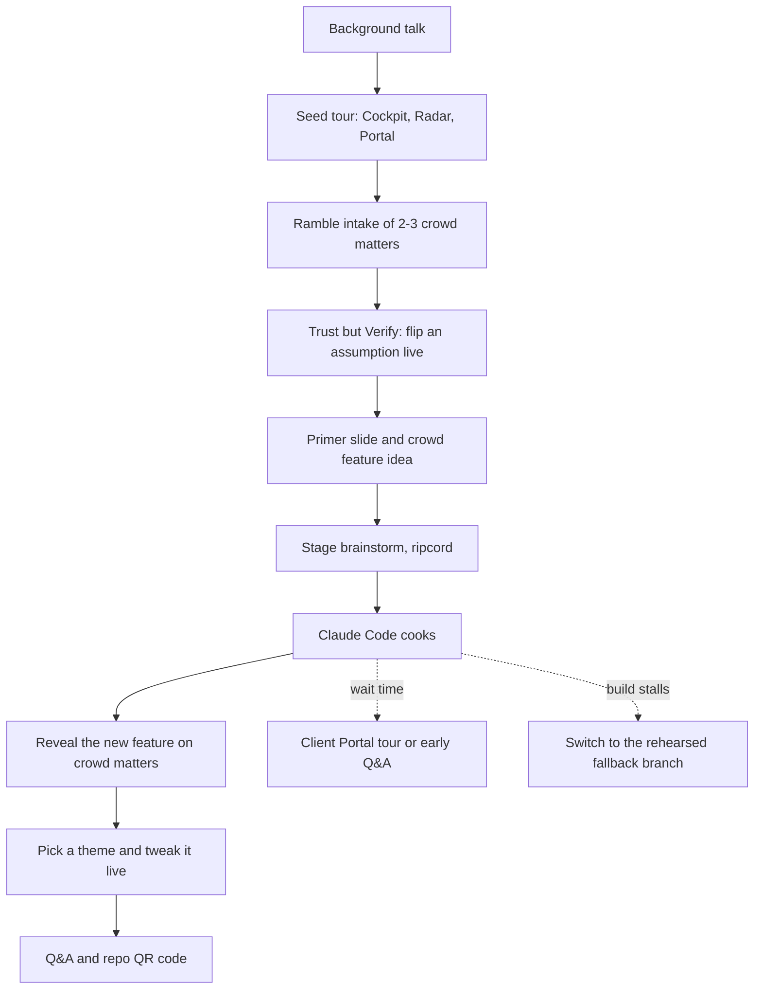
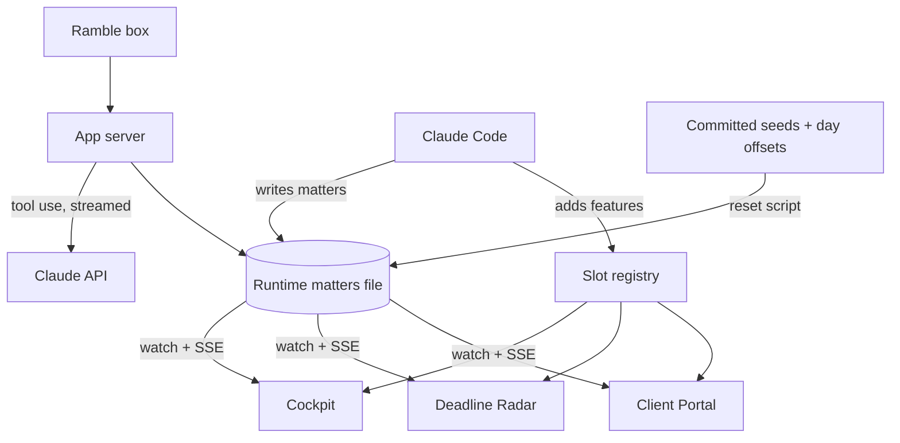
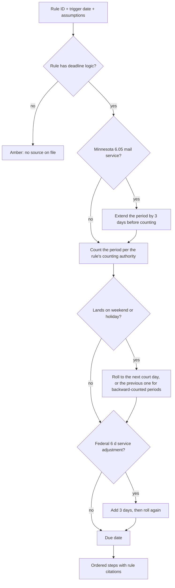

# Matter Cockpit CLE Vibe-Coding Demo - Plan

## Goal Capsule

- **Objective:** At a 45-minute Minnesota CLE in December 2026, lawyers from every practice area in the room watch Damien build a real, beautiful legal app feature live from their own ideas, see it work on matters from their own practice, and leave able to point Claude Code at the same free repo and do it themselves.
- **Means:** A purpose-built, open-source stage kit (Matter Cockpit) prepared like a cooking show, with a clean main branch for the live build and pre-built fallback branches.
- **Product authority:** Damien decides product direction, visual taste, and run of show; technical choices follow engineering best practice.
- **Open blockers:** None for building. Damien's theme pick (U9) and his one screen recording (U12) gate only those steps; see Open Questions.
- **Execution profile:** One PR from a feature branch built in a worktree under `~/worktrees/`, merged to `main`. The six fallback branches (U11) branch from that merged `main` and are never merged. Per Damien's worker policy, the orchestrating session decomposes units to workers and verifies their artifacts itself.
- **Stop conditions:** Stop and ask only for a credential with no prior authorization; the theme pick proceeds provisionally under U9, and everything else follows the Decision Bar.
- **Finisher:** The implementing session ships the PR, builds the fallback branches, and runs the rehearsal evidence; Damien records the one screen capture and presents.

---

## Product Contract

### Summary

Matter Cockpit is a small, open-source web app with three views over one shared set of legal matters: Cockpit (one matter in depth), Deadline Radar (every deadline on one wall), and Client Portal (what the client sees). Damien adds matters on stage by rambling into an intake box, and a Trust but Verify panel shows the rule text, date math, and reasoning behind every deadline. Then the room proposes a feature, a compressed brainstorm scopes it, and Claude Code builds it live in about ten minutes.

### Problem Frame

Most lawyers have heard that "anyone can build software with AI" and assume it does not apply to them. A CLE room mixes litigators, transactional lawyers, patent prosecutors, bankruptcy lawyers, family lawyers, employment lawyers, and regulatory lawyers, so a demo built around one practice area loses most of the audience. The session runs 45 minutes, and background and Q&A take most of it, which leaves roughly ten minutes of build time.

The existing open-source legal AI platforms (Mike, BigLaw, LQ.AI) are large, multi-service codebases. On those, Claude Code spends minutes reading before it writes, and a multi-container stack adds live-failure risk. A CLE audience also expects professional skepticism: a demo that shows AI output without showing its sources would undercut the ethics message.

### Key Decisions

- **Purpose-built stage kit, with an ecosystem slide.** A small codebase lets Claude Code build in minutes, and the slide credits Mike, BigLaw, and LQ.AI as repos attendees can explore afterward. (session-settled: user-approved — chosen over building on Mike, BigLaw, or LQ.AI directly: their size and multi-service stacks slow and endanger a ten-minute live build.) Governs R36.
- **Three views over one matter set.** Every view reads the same matters, so a matter entered once appears everywhere. (session-settled: user-directed — chosen over a single Matter Cockpit view: Damien added Deadline Radar and Client Portal.) Governs R1–R4.
- **Damien does all input.** No attendee phones and no hosted submission backend. (session-settled: user-directed — chosen over live QR intake: Damien types or dictates every crowd matter.) Governs R7.
- **Two intake channels: the app's Ramble box for matters, Claude Code for features.** Claude Code also serves as the intake fallback. (session-settled: user-directed — chosen over app-only or Claude-Code-only structuring.) Governs R7, R14, R23.
- **The AI picks the rule; code does the math; rule text comes from a bundled library.** Invented rule text or arithmetic on a projector in front of lawyers would sink the demo. (session-settled: user-approved — chosen over AI-written rule text: broader coverage, but a real risk of invented rule text on screen.) Governs R16–R21, R38.
- **Source labels on every field.** Distinguishing "you said" from "AI invented" makes the hallucination lesson visible. (session-settled: user-approved — chosen over unlabeled fields.) Governs R12.
- **Compressed, ripcord-able stage brainstorm.** The full brainstorm-plan-build cycle cannot fit in ten minutes, so the stage version asks questions until Damien pulls the ripcord. (session-settled: user-directed — Damien proposed the ripcord variant.) Governs R23–R26.
- **Design comes last.** Theme choice and live tweaks close the demo, after the substantive parts. (session-settled: user-directed — chosen over opening with a quick theme tweak.) Governs R33.
- **Cooking-show fallbacks live on branches, never on main.** Main stays clean so the live build is real. Governs R28, R29.

### Actors

- A1. Damien: presenter and the only person who types or dictates, driving Claude Code through Remote Control in Chrome and using his Chrome dictation app for voice.
- A2. The audience: CLE attendees who call out matters and feature ideas and vote on themes.
- A3. The app's intake AI: structures rambles, asks follow-ups, embellishes, picks rules, and writes reasoning.
- A4. Claude Code: runs the stage brainstorm, builds features and theme tweaks, and serves as the intake fallback.
- A5. Attendees after the session: clone the repo and point their own Claude Code at it.

### Requirements

**Views and shared data**

- R1. All views read and write one shared set of matters, and a new or changed matter appears in every view without a reload.
- R2. Cockpit shows one matter in depth: parties, practice area, court or forum, timeline of events, documents, and deadlines.
- R3. Deadline Radar shows every matter's deadlines on one visual wall, ordered by urgency, with countdowns and practice-area color coding.
- R4. Client Portal shows a client-facing view of a matter in plain language: status, next steps, upcoming dates, and shared documents.
- R5. The app ships with seven seed matters, one each for litigation, transactional, patent prosecution, bankruptcy, family, employment, and regulatory practice, set in Minnesota or federal forums where a forum applies.
- R6. Seed matter dates are anchored relative to the current date, so the Radar always shows upcoming deadlines rather than lapsed ones.

**Ramble intake**

- R7. A Ramble box accepts free-form, stream-of-consciousness text typed or dictated by Damien and turns it into a structured matter.
- R8. After a ramble, the app asks at most three targeted follow-up questions about facts it needs, chiefly deadline triggers such as a service date or a petition date.
- R9. Embellish is available at every intake step and fills every remaining field with detailed synthetic data consistent with what Damien has said.
- R10. Surprise Me builds a complete synthetic matter from nothing, optionally limited to a practice area Damien picks.
- R11. The matter builds on screen progressively as the AI extracts it, then lands in all three views with a visible arrival animation.
- R12. Every field carries a visible source label distinguishing what Damien stated from what the AI inferred or invented, and a toggle highlights only the stated facts.
- R13. Every matter, seed or crowd-entered, is plainly synthetic, and the app never asks for or stores real client information.
- R14. Damien can add a matter through Claude Code instead of the Ramble box, and the result matches a Ramble-created matter.

**Trust but Verify**

- R15. Selecting any deadline or AI-derived fact opens a Trust but Verify panel that shows its work.
- R16. The panel shows the governing rule's verbatim text from the bundled library, with a link to its official source.
- R17. The panel shows the date math as ordered steps: trigger date, period added, landing day, any weekend or holiday roll-forward with its rule, and the final due date.
- R18. The AI chooses the governing rule and trigger, and deterministic code computes every date.
- R19. The panel lists each assumption behind a deadline as a toggle, and flipping one recomputes the deadline and redraws the math live; for example, switching a federal complaint from personal service to a Rule 4(d) waiver moves the answer deadline from 21 days after service to 60 days after the waiver request was sent under Fed. R. Civ. P. 12(a)(1)(A)(ii).
- R20. The panel shows a plain-English reasoning chain for why the rule applies, with the same stated-versus-inferred labels as R12.
- R21. When no bundled rule matches, or the rule has no computed-deadline logic, the panel shows the reasoning and an amber "No source on file. Verify independently." warning instead of a date.

**Rules library**

- R22. The library bundles verbatim text of all the Federal Rules of Civil Procedure, all the Minnesota Rules of Civil Procedure, and all the Minnesota General Rules of Practice, plus the targeted sections the seed matters rely on (such as Fed. R. Bankr. P. 3002(c), 37 C.F.R. 1.134 and 1.136, 42 U.S.C. § 2000e-5(e)(1), and the APA comment-period provisions), each with a link to its official source.
- R38. About 25 deadline rules carry computed-deadline logic, covering every seed matter's deadlines.

**Stage brainstorm**

- R23. A single stage command starts a compressed brainstorm on the crowd's feature idea inside Claude Code, asking one question at a time with a recommended answer attached.
- R24. Damien answers as many questions as time allows, and the ripcord phrase "answer everything else yourself" makes Claude Code decide every remaining question on its recommendations and start building immediately.
- R25. The stage brainstorm carries a built-in time budget, so it pulls the ripcord itself when the budget runs out.
- R26. The stage brainstorm shrinks oversized ideas to a slice that looks finished within the build budget, and states the shrink out loud.
- R27. A primer slide shows six example feature ideas, and the room may propose any idea, rehearsed or not.
- R28. Each of the six example ideas has a rehearsed, known-good implementation on its own fallback branch.
- R29. The main branch carries none of the six features, so any live build is genuinely new work.

**Visual design and themes**

- R30. The app looks like a premium legal product, modern and elegant, and stays legible from the back row on a washed-out venue projector.
- R31. In prep, Damien and Claude sketch rough visual options together to settle three distinct, finished visual directions grounded in UX and UI best practice.
- R32. The three directions ship as themes the audience can switch between live, and each covers all three views and the Trust but Verify panel.
- R33. At the end of the demo, the audience picks a theme and calls out tweaks, and Damien has Claude Code apply them live in about a minute each.

**Stage operation and attendee takeaway**

- R34. Damien drives everything from Chrome via Remote Control, and the running app is viewable in a presentation browser that shows each change Claude Code makes without a manual restart.
- R35. A full rehearsed run is recorded as a last-resort backup video.
- R36. The repo is public and free, and its README tells attendees how to run it and point Claude Code at it, assuming they have Claude Code and an API key.
- R37. Without an API key, the app still runs with the seed matters, Trust but Verify, and Surprise Me drawn from a canned pool, and it explains plainly what the key unlocks.

### Key Flows

- F1. Ramble intake
  - **Trigger:** An attendee calls out a matter and Damien starts dictating.
  - **Actors:** A1, A2, A3
  - **Steps:** Damien rambles; the matter builds progressively; the app asks up to three follow-ups; Damien answers some, gets an answer from the room, or presses Embellish; the matter lands in all three views.
  - **Covered by:** R7–R12
- F2. Verify a deadline
  - **Trigger:** Damien selects a deadline on the Radar or Cockpit.
  - **Actors:** A1, A3
  - **Steps:** The panel opens with rule text, date-math steps, assumptions, and reasoning; Damien flips an assumption; the date and math redraw.
  - **Covered by:** R15–R21
- F3. Crowd feature build
  - **Trigger:** The room proposes a feature after seeing the primer slide.
  - **Actors:** A1, A2, A4
  - **Steps:** Damien runs the stage command and dictates the idea; Claude Code asks questions with recommended answers; Damien relays the room's answers until time runs short; Damien pulls the ripcord or the budget does; Claude Code builds; the feature appears in the running app on the room's matters.
  - **Covered by:** R23–R29, R34
- F4. Stage run of show (the build phase fills its wait time)



### Acceptance Examples

- AE1. **Covers R8, R9.** **Given** Damien rambles about a fired employee but never says when, **when** the app asks "When was the termination?" and Damien presses Embellish, **then** the app fills a plausible termination date labeled invented and computes the EEOC charge deadline from it.
- AE2. **Covers R18, R19.** **Given** a federal complaint served personally with an answer due 21 days later, **when** Damien flips the service assumption to a Rule 4(d) waiver, **then** the due date moves to 60 days after the waiver request was sent, rolling to the next business day if needed, and the math steps show Rule 12(a)(1)(A)(ii) and any Rule 6(a)(1)(C) roll-forward.
- AE3. **Covers R21.** **Given** a regulatory matter whose AI-chosen authority has no computed-deadline logic, **when** Damien opens its deadline, **then** the panel shows the reasoning and the amber no-source warning instead of a date.
- AE4. **Covers R24, R25.** **Given** the stage brainstorm has asked two of five questions, **when** Damien says "answer everything else yourself," **then** Claude Code states its remaining choices in one short list and begins building without another question.
- AE5. **Covers R37.** **Given** an attendee clones the repo with no API key, **when** they press Surprise Me, **then** a complete canned matter appears, and the Ramble box explains that it needs a key.

### Success Criteria

- In rehearsal, each of the six primer ideas builds from the stage command to a working feature in about ten minutes or less.
- A ramble becomes a finished matter card in under a minute.
- Every seed matter shows at least one upcoming deadline with full Trust but Verify detail on any demo date.
- A cold clone reaches a running app by following the README in a few commands.
- The rehearsal audience reaction test: a lawyer who watches the run says they would have paid real money for the result.

### Scope Boundaries

**Deferred for later**

- An in-app microphone button (a candidate crowd idea).
- Attendee phone submission through a QR code.
- A hosted public demo URL.
- Computed-deadline logic beyond the deadline rules in R38.

**Outside this product's identity**

- Real deadline docketing or calendaring that a firm would rely on.
- Logins, multi-user accounts, a database server, or real client data.
- Building on Mike, BigLaw, or LQ.AI; they appear only on the ecosystem slide.

### Dependencies / Assumptions

- Venue internet is fast and reliable, so no hotspot plan is required.
- Damien runs Claude Code on his home box through Remote Control and dictates with his Chrome dictation app.
- Minnesota court rules on revisor.mn.gov and the federal rules are public domain and may be bundled verbatim with attribution.
- Attendees have Claude Code and a Claude API key.

### Outstanding Questions

All questions the brainstorm deferred to planning are resolved in the Planning Contract: remote viewing (KTD10), rule sources (KTD9), holiday calendars (KTD8), the six primer ideas (KTD13), and stage-command packaging (KTD12).

### Sources / Research

- Mike: https://github.com/open-legal-products/mike (AGPL-3.0; Next.js, Express, Supabase, and object storage in Docker).
- BigLaw: https://github.com/discover-legal/BigLaw (Apache-2.0; Go binary, Postgres with pgvector, offline replay mode; README says under construction).
- LQ.AI: https://github.com/LegalQuants/lq-ai (Apache-2.0; eight Docker services, about 6 GB RAM).
- Minnesota General Rules of Practice: https://www.revisor.mn.gov/court_rules/gp/
- Minnesota Rules of Civil Procedure: https://www.revisor.mn.gov/court_rules/rule/cp-toh/
- Lesson from the alea-intake rehearsal on 2026-11-08: example stories with fixed dates showed most deadlines as lapsed, which R6 prevents.

**Product Contract preservation:** changed: R19's example and AE2 — the original example added Rule 6(d) mail days to a complaint answer, but a complaint is served under Rule 4 and Rule 6(d) reaches only Rule 5(b)(2)(C), (D), or (F) service, so the toggle now flips personal service to a Rule 4(d) waiver; the requirement's intent (flip an assumption, watch the date and math redraw) is unchanged. Restructured, no scope change: the five "Deferred to Planning" questions were resolved in place by KTD8–KTD10, KTD12, and KTD13.

---

## Planning Contract

### Key Technical Decisions

- KTD1. **Vite, React, and TypeScript, styled with Tailwind on CSS-variable design tokens.** Claude Code writes this stack fastest and most reliably, which is what a ten-minute live build needs; tokens as CSS variables make every theme and live tweak a token edit (R30–R33).
- KTD2. **One small Node server in the same repo, started with the client by a single `npm run dev`.** It holds the matter store, the intake AI calls, and the API key, so the key never reaches the browser. Hono keeps it to a few files.
- KTD3. **Matters live in one plain JSON file that the server watches and pushes to every view over server-sent events.** Claude Code adds a matter by writing that file (R14), new crowd features read the same data with no wiring, and every open tab updates within a second (R1). The file stores each deadline's rule ID, trigger date, and assumptions only, never a computed date; the shared engine computes dates and steps on read, so a matter written by Claude Code gets the same code-computed dates as a Ramble matter. Every file-watch change is validated against the schema, including KTD7's rule-ID catalog, and a stored due date is rejected. Seeds live in committed files; the runtime file is gitignored and rebuilt by a reset script, so rehearsals start clean.
- KTD4. **Seed dates are stored as day offsets from "today" and materialized at reset.** Covers R6; the alea-intake rehearsal on 2026-11-08 showed fixed dates turning every deadline red.
- KTD5. **The app reads its Claude key from `MATTER_COCKPIT_API_KEY` (or a key file path), never `ANTHROPIC_API_KEY`.** Setting `ANTHROPIC_API_KEY` in a shell that runs Claude Code breaks Remote Control on Damien's box; a distinct name keeps the app key out of Claude Code's environment. Default model is the current Sonnet (`claude-sonnet-5-5`), overridable by env, chosen for intake speed under a one-minute budget (Success Criteria).
- KTD6. **Intake uses Claude tool use with streamed tool input, and every field carries provenance.** Each field is `{value, source: stated | inferred | invented, evidence}`; streaming lets the card build progressively (R11) and provenance drives the labels (R12, R20). The same schema serves Ramble, Embellish, and Surprise Me (R7–R10).
- KTD7. **The model may only choose a deadline rule by ID from the bundled catalog, or "none".** The server rejects any other value; "none" or an uncomputable rule routes to the amber warning (R21). Rule text and dates never come from the model (Key Decision governing R16–R21, R38).
- KTD8. **The deadline engine is pure, dependency-free TypeScript with hand-encoded holiday calendars.** Federal legal holidays follow 5 U.S.C. § 6103 and Fed. R. Civ. P. 6(a)(6); Minnesota holidays follow Minn. Stat. § 645.44 subd. 5, where a Saturday holiday moves to the preceding Friday. Each computation returns ordered steps that the panel renders verbatim (R17). A small encoded calendar is easier to verify and cite than a general holiday library.
- KTD9. **Rule text is ingested once by an offline script and committed as JSON with source URL, retrieval date, and version.** FRCP text comes from the uscourts.gov December 1, 2025 pamphlet PDF; Minn. R. Civ. P. and Minn. Gen. R. Prac. from revisor.mn.gov per-rule pages (`/court_rules/cp/id/<n>/`, `/court_rules/gp/id/<n>/`); 37 C.F.R. from the eCFR versioner API; U.S. Code sections from govinfo `link/uscode`; Fed. R. Bankr. P. 3002 from the uscourts.gov FRBP pamphlet; Minn. Stat. §§ 363A.28 subd. 3, 645.15, and 645.44 subd. 5 from revisor.mn.gov as short excerpts. The counting authorities the non-civil deadlines follow join the targeted sections: Fed. R. Bankr. P. 9006(a), 35 U.S.C. § 21(b), and 37 C.F.R. § 1.7. Cornell LII pages serve as navigation links only, because LII claims copyright in its compilation. Nothing fetches rules at stage time.
- KTD10. **The app serves client and API on one port bound to 127.0.0.1:8982, and the home box publishes it to the tailnet with `tailscale serve`, which Damien's presentation Chrome opens by MagicDNS name.** Nothing binds 0.0.0.0, so the unauthenticated API that spends the key never reaches the home LAN or an attendee's café Wi-Fi. Vite's allowed hosts come from an env var holding the MagicDNS name, empty by default; `allowedHosts: true` is never committed. Hot module reload makes each Claude Code change appear without a restart (R34). Port 8982 comes from the deterministic port hash and was free on 2026-11-08.
- KTD11. **New features plug into a slot registry.** Views expose named slots (Cockpit tabs, Cockpit sidebar, Radar overlay, Portal sections, global toolbar), and each feature is one self-contained folder registered in one file. A feature that needs the model adds a `server/features/<slug>.ts` route that loads automatically and calls a shared AI helper, which applies the KTD5 key, the model choice, and the standard needs-a-key response (R37). The server runs under a watch-reloader and SSE clients reconnect on their own, so a live build never needs a manual restart (R34). The repo's `CLAUDE.md` teaches this, so a live build touches few files and every fallback branch stays a small diff.
- KTD12. **The stage brainstorm ships as a self-contained project skill invoked as `/cook`.** It needs no Compound Engineering plugin, so attendees can use it as-is. It stamps a start time, asks one question at a time with a recommendation, honors the ripcord phrase, ripcords itself at the budget (four minutes by default), shrinks oversized ideas aloud, then builds straight into a slot and runs typecheck and tests before announcing (R23–R26). (session-settled: user-directed — Damien proposed answering as time allows with an "answer everything else yourself" ripcord, over the full brainstorm-plan-build cycle.)
- KTD13. **The six primer ideas are a client-update email drafter, a conflict check across matters, a risk heat map, a budget burn-down, a "what happens next" client explainer, and Ask the Rules.** Each spans a different view or slot, and each touches every practice area's matters.
- KTD14. **Fallback branches are built by running `/cook` itself during rehearsal, timed, on `fallback/<slug>` branches cut from the merged `main`.** Each build is both the fallback and the proof of the ten-minute budget (R28, Success Criteria).
- KTD15. **Projector legibility is a hard token constraint.** Body text meets at least 7:1 contrast, nothing renders below 18 px at 1920×1080, and no meaning rides on color alone; every theme passes an automated contrast check (R30).
- KTD16. **Tests concentrate where a wrong answer is visible to lawyers.** The deadline engine gets exhaustive unit tests; intake tests replay recorded Claude responses; Playwright drives the main flows in no-key and recorded-AI modes; one live smoke test runs only when a key is present.

### High-Level Technical Design

Data flow: one store feeds every surface, and Claude Code writes to the same store the app does.



Intake protocol:

```mermaid
sequenceDiagram
  participant D as Damien
  participant UI as Ramble UI
  participant SV as App server
  participant AI as Claude
  participant EN as Deadline engine
  D->>UI: ramble (typed or dictated)
  UI->>SV: intake request
  SV->>AI: extract with catalog of rule IDs
  AI-->>SV: streamed fields with provenance, up to 3 follow-ups, rule ID or none
  SV-->>UI: progressive card
  D->>UI: answer follow-ups or press Embellish
  UI->>SV: embellish with stated facts
  AI-->>SV: remaining fields marked invented
  SV->>EN: rule ID + trigger + assumptions
  EN-->>SV: due date + ordered steps, or uncomputable
  SV->>SV: write matter to store (triggers only; dates recomputed on read)
```

Deadline computation, which also drives the assumption toggles:



### Output Structure

```text
.claude/skills/cook/SKILL.md
CLAUDE.md
README.md
THIRD-PARTY.md
package.json
data/seed/            committed seed matters and canned Surprise pool
data/rules/           committed rule JSON from ingestion
data/matters.json     runtime store (gitignored)
scripts/ingest-rules/ offline rule ingestion
scripts/reset-demo.ts rebuild runtime store from seeds
server/               Hono app: store, SSE, intake AI
src/engine/           deadline engine and holiday calendars
src/views/            Cockpit, Radar, Portal
src/intake/           Ramble, follow-ups, Embellish, Surprise Me
src/verify/           Trust but Verify panel
src/features/         slot registry and feature folders
src/theme/            design tokens and three themes
tests/                unit and Playwright suites
docs/rehearsal/       runbook and timing evidence
```

### Assumptions

- Damien has, or will provision, a Claude API key for the app; until one is located, everything except live intake builds and tests in no-key and recorded modes.
- The CLE runs in December 2026; seed offsets make the exact date irrelevant.
- Damien's laptop is on his tailnet during the talk.

### Risks

| Risk | Mitigation |
|---|---|
| A live `/cook` build overruns ten minutes | Budget ripcord (KTD12), small-diff slots (KTD11), and the matching fallback branch (KTD14) |
| Intake latency drags past a minute on stage | Streamed fields keep the screen moving (KTD6); Surprise Me and the Claude Code path (R14) cover a stall |
| A wrong date on the projector | Engine test-first against rule text (U4); unknown or uncomputable rules show the amber warning (R21) |
| A source site changes its page structure | Rules are ingested once and committed (KTD9); the stage never fetches |
| The app key leaks into Claude Code's environment | Distinct variable name and gitignored env file (KTD5) |

### Open Questions

- Which visual direction and tweaks Damien picks after the sketch session (taste; gates U9's final themes only; filed through `cockpit-decide`).
- Where Damien's Claude API key for the app lives; search prior authorizations and `~/.config/` listings first, then ask with a paste-safe prompt (gates the live smoke test and live rehearsal only).
- Damien's one screen recording of a full rehearsal, Claude Code pane included (gates R35 only).

---

## Implementation Units

| U-ID | Title | Key files | Depends on |
|---|---|---|---|
| U1 | Scaffold and stage plumbing | `package.json`, `server/index.ts`, `CLAUDE.md` | none |
| U2 | Matter store and live sync | `server/store.ts`, `src/data/useMatters.ts` | U1 |
| U3 | Rules library ingestion | `scripts/ingest-rules/`, `data/rules/` | U1 |
| U4 | Deadline engine | `src/engine/` | U3 |
| U5 | Intake AI service | `server/intake/` | U2, U4, U8 |
| U6 | Three views and slot registry | `src/views/`, `src/features/registry.ts` | U2, U4, U8 |
| U7 | Trust but Verify panel | `src/verify/` | U4, U6 |
| U8 | Seed matters and canned pool | `data/seed/` | U2, U4 |
| U9 | Visual directions and themes | `src/theme/` | U6 |
| U10 | `/cook` stage skill | `.claude/skills/cook/SKILL.md` | U6 |
| U11 | Six fallback branches | `fallback/<slug>` branches | U1–U10 merged |
| U12 | Stage materials and rehearsal | `docs/rehearsal/`, `README.md`, slides Artifact | U11 |

### U1. Scaffold and stage plumbing

- **Goal:** A cold clone runs the client and server with one command, reachable on the tailnet with hot reload.
- **Requirements:** R34, R36; KTD1, KTD2, KTD10.
- **Dependencies:** none.
- **Files:** `package.json`, `vite.config.ts`, `tsconfig.json`, `server/index.ts`, `server/ai.ts`, `server/features/README.md`, `index.html`, `src/main.tsx`, `.gitignore`, `.env.example`, `CLAUDE.md`, `README.md`, `THIRD-PARTY.md`, `tests/smoke.spec.ts`.
- **Approach:**
  1. Scaffold the client and server with pinned versions and log each dependency's license in `THIRD-PARTY.md`.
  2. Serve the Hono API inside the Vite dev server on one port; read `HOST` (default 127.0.0.1), `PORT` (default 8982), and the allowed-hosts env var (KTD10); run server code under a watch-reloader (KTD11).
  3. Write `CLAUDE.md` for future Claude Code sessions: the stack, the slot pattern (filled in by U6), the store schema (by U2), and the rule that features go in `src/features/`.
  4. Gitignore `.env*` except `.env.example`, `data/matters.json`, and test output.
- **Test scenarios:**
  - Starting dev serves the client page and a server health endpoint on the configured port.
  - An edit to a client file appears in an open browser without a reload.
  - An edit to a server route takes effect without a manual restart, and SSE clients reconnect.
  - With `HOST` unset, the API refuses connections on a non-loopback interface.
- **Verification:** A Playwright smoke test loads the page through the `tailscale serve` MagicDNS URL on the home box.

### U2. Matter store and live sync

- **Goal:** One file-backed store that every view, the intake server, and Claude Code share, with sub-second push updates.
- **Requirements:** R1, R6, R13, R14; KTD3, KTD4.
- **Dependencies:** U1; the engine module from U4 plugs in for recompute-on-read.
- **Files:** `server/store.ts`, `server/events.ts`, `src/data/schema.ts`, `src/data/useMatters.ts`, `scripts/reset-demo.ts`, `tests/store.test.ts`.
- **Approach:**
  1. Define the matter schema once (validated at the server boundary): parties, practice area, forum, timeline events, documents, deadlines with rule ID, trigger, and assumptions (never computed dates, per KTD3), client-facing status and next steps in plain language, an internal-only flag on fields the Portal must hide, and per-field provenance (KTD6).
  2. Watch the runtime file; on a valid change, recompute deadlines with the shared engine and broadcast; on an invalid write (for example a malformed hand edit, a rule ID outside the catalog, or a stored due date), keep the last good state and log a readable error that names the field.
  3. `reset-demo` materializes seed day offsets against today and writes the runtime file.
  4. Document the schema and "add a matter by editing `data/matters.json`" in `CLAUDE.md`.
- **Test scenarios:**
  - Adding a matter through the API broadcasts it to two connected clients.
  - An external write to the file (simulating Claude Code) reaches connected clients within one second.
  - A malformed external write leaves clients on the last good state and logs which field failed.
  - An external write with a rule ID outside the catalog, or with a hand-written due date, is rejected the same way.
  - A matter written to the file with only a trigger date reaches clients with the engine-computed due date.
  - Reset with a seed offset of +12 days produces a date 12 days after the reset date.
- **Verification:** Store tests pass, and two browser tabs show a hand-added matter without reloading.

### U3. Rules library ingestion

- **Goal:** Committed, verbatim, attributed rule text for every set R22 names.
- **Requirements:** R16, R22; KTD9.
- **Dependencies:** U1.
- **Files:** `scripts/ingest-rules/frcp.ts`, `scripts/ingest-rules/mn-court-rules.ts`, `scripts/ingest-rules/federal-sections.ts`, `scripts/ingest-rules/mn-statutes.ts`, `data/rules/*.json`, `tests/rules-library.test.ts`.
- **Approach:**
  1. One ingester per source family from KTD9; each record carries ID, citation, heading, subdivisions, verbatim text, official source URL, navigation URL, retrieval date, and source version.
  2. FRCP comes from PDF text, so split by rule headings and spot-check against LII per-rule pages for completeness, never copying LII text.
  3. Revisor pages put committee comments after the rule text; keep the rule text and drop comments.
  4. The eCFR API needs compressed requests.
  5. Commit the output; the ingester is a maintenance tool, never a stage step.
- **Test scenarios:**
  - The FRCP set contains every rule number from 1 through 87, including lettered rules such as 4.1, 5.1, and 65.1.
  - Fed. R. Civ. P. 6(a)(6) text names Juneteenth National Independence Day.
  - Minn. R. Civ. P. 6.01 and 12.01 exist with subdivision text.
  - The Minn. Gen. R. Prac. set contains rule 115.
  - 37 C.F.R. 1.136 text includes the extension-of-time provisions.
  - Every record has a non-empty source URL and retrieval date.
- **Verification:** Library tests pass, and the record counts per set land in the PR description.

### U4. Deadline engine

- **Goal:** Deterministic due dates with ordered, cited steps for about 25 deadline rules.
- **Requirements:** R17, R18, R19, R21, R38; KTD7, KTD8; AE2, AE3.
- **Dependencies:** U3 (rule IDs).
- **Files:** `src/engine/rules.ts`, `src/engine/compute.ts`, `src/engine/calendars/federal.ts`, `src/engine/calendars/minnesota.ts`, `tests/engine.test.ts`.
- **Approach:**
  1. Each deadline rule declares its rule ID, trigger event, period and unit, its counting authority (rule ID plus calendar), service adjustments with their position in the computation (KTD8 and the computation diagram), forum calendar, and the assumptions it exposes as toggles.
  2. The set covers every seed matter's deadlines at minimum: federal and Minnesota answer deadlines (Fed. R. Civ. P. 12(a), Minn. R. Civ. P. 12.01), mail-service additions (Fed. R. Civ. P. 6(d), Minn. R. Civ. P. 6.05), the Fed. R. Bankr. P. 3002(c) proof-of-claim period, 37 C.F.R. 1.134 response periods with 1.136(a) extensions, the EEOC 300-day and Minnesota Human Rights Act one-year charge windows, the rulemaking comment period keyed to the notice's stated close date under the bundled APA provision, Fed. R. Civ. P. 33 interrogatory responses (the Rule 6(d) mail toggle's home, since Rule 6(d) reaches only Rule 5 service), and contract-derived deadlines whose source is the matter's own agreement.
  3. Output is either a due date with ordered steps, each citing its rule ID, or an uncomputable result carrying the reason (R21).
  4. Calendars encode observed dates per KTD8, covering 2026 through 2028.
- **Execution note:** Implement test-first; each rule's tests come from the rule text, not from the implementation.
- **Test scenarios:**
  - Covers AE2. An FRCP 12(a) answer for a complaint served personally on a Tuesday lands 21 days later; switching to a Rule 4(d) waiver moves it to 60 days after the request was sent under Rule 12(a)(1)(A)(ii), and a Saturday landing rolls to Monday with a Rule 6(a)(1)(C) step.
  - Rule 33 interrogatories served by mail under Rule 5(b)(2)(C): a 30-day period ending on a Saturday rolls to Monday, then Rule 6(d) adds three days, giving Thursday.
  - A Minnesota Rule 6.05 mail-service adjustment extends the period before counting under Rule 6.01.
  - The proof-of-claim steps cite Fed. R. Bankr. P. 9006(a) and the patent response steps cite 35 U.S.C. § 21(b) and 37 C.F.R. § 1.7, not Fed. R. Civ. P. 6(a).
  - A rulemaking comment deadline equals the notice's stated close date.
  - A federal period ending on Thanksgiving rolls to the Friday after; the Minnesota treatment of that Friday follows the reading verified against Minn. Stat. § 645.44 subd. 5 and Minn. R. Civ. P. 6.01, recorded with its citation in the calendar file.
  - A Minnesota holiday falling on a Saturday is observed the preceding Friday.
  - Juneteenth 2027 counts as a legal holiday in both calendars.
  - Fed. R. Bankr. P. 3002(c) computes 70 days after the order for relief in a voluntary case.
  - 37 C.F.R. 1.134 gives a three-month shortened period, and a 1.136(a) toggle extends it month by month up to six months.
  - The EEOC window computes 300 days from the discriminatory act.
  - Covers AE3. A rule ID with no deadline logic returns uncomputable with a reason.
  - An unknown rule ID returns uncomputable, never an exception.
- **Verification:** Engine tests pass, and each rule's test file cites the rule text it encodes.

### U5. Intake AI service

- **Goal:** Ramble, follow-ups, Embellish, and Surprise Me produce schema-valid matters with provenance, streamed, with a no-key fallback.
- **Requirements:** R7, R8, R9, R10, R11, R13, R18, R20, R37; KTD5, KTD6, KTD7; AE1, AE5.
- **Dependencies:** U2, U4, U8 (canned pool).
- **Files:** `server/intake/client.ts`, `server/intake/prompts.ts`, `server/intake/routes.ts`, `server/intake/canned.ts`, `tests/intake.test.ts`, `tests/no-secrets.test.ts`, `tests/fixtures/intake/*.json`.
- **Approach:**
  1. Load the `claude-api` skill before writing this unit, and use the current SDK and model guidance.
  2. One tool schema serves all three modes; the prompt gives the deadline-rule catalog (IDs and one-line descriptions), requires every field's source label, caps follow-ups at three, and forbids real-person data.
  3. Validate tool output against the matter schema and the rule-ID enum; on a validation failure, retry once, then keep the valid fields and mark the rest for Embellish.
  4. Without a key, Ramble and Embellish return a clear "needs a key" state, and Surprise Me draws from the canned pool (U8).
  5. Record fixtures from real calls once a key exists, storing only the streamed response events and tool output, never request headers or the raw HTTP exchange; tests replay them.
- **Test scenarios:**
  - Covers AE1. A replayed ramble about a fired employee with no date yields a termination-date follow-up; Embellish fills the date labeled invented, and the engine returns the EEOC deadline.
  - A ramble that states the client's name labels that field stated, with an evidence quote.
  - A model response naming a rule ID outside the catalog is rejected, and the deadline becomes uncomputable.
  - A response with five follow-up questions is cut to three.
  - Covers AE5. With no key, Surprise Me returns a complete canned matter, and Ramble returns the needs-a-key state.
  - A repository scan fails if any file under `tests/fixtures/` or `data/` contains an Anthropic key pattern or an `x-api-key` header.
  - Live smoke, key present only: a short real ramble returns a schema-valid matter in under 60 seconds.
- **Verification:** Intake tests pass on replayed fixtures; the live smoke result and its timing land in the PR description.

### U6. Three views and slot registry

- **Goal:** Cockpit, Deadline Radar, Client Portal, and the Ramble UI on shared data, with named slots for new features.
- **Requirements:** R2, R3, R4, R11, R12, R30; KTD1, KTD11, KTD15; F1.
- **Dependencies:** U2, U4, U8 (seed matters and computed deadlines).
- **Files:** `src/views/Cockpit.tsx`, `src/views/Radar.tsx`, `src/views/Portal.tsx`, `src/intake/Ramble.tsx`, `src/intake/SourceLabel.tsx`, `src/features/registry.ts`, `src/features/README.md`, `tests/views.spec.ts`.
- **Approach:**
  1. Apply the `frontend-design` skill; build on neutral tokens that U9 replaces.
  2. A persistent top bar holds the three view tabs, the Ramble entry point, and the theme switcher; a matter list selects the active matter for Cockpit and Portal, and a newly arrived matter is highlighted in the list without changing the active selection.
  3. Ramble moves through named states, each with its own on-screen content and a persistent Embellish control: idle, streaming (the card fills field by field), awaiting follow-up (one question at a time with a Skip action), embellishing, partial failure (unfilled fields flagged for Embellish), needs a key, and done (the matter animates onto the Radar).
  4. The Radar groups deadlines into named urgency bands (overdue, this week, this month, later) with countdown text, puts uncomputable deadlines in a "Needs verification" band with the amber marker in place of a countdown, and pairs every practice-area color with a text or icon label (KTD15).
  5. The Portal renders only the client-facing fields from the schema (U2) and never internal-only fields.
  6. Source labels follow R12, with a toggle that highlights stated facts only.
  7. The registry exposes the slots KTD11 names, each with one example registration; document it in `src/features/README.md` and `CLAUDE.md`.
  8. Selecting a deadline or an AI-derived fact anywhere opens the U7 panel over the current view.
- **Test scenarios:**
  - The Radar lists deadlines from all seven seed matters in urgency order with countdowns.
  - Selecting a Radar deadline opens the Trust but Verify panel over the Radar; the panel's Open matter action switches to that matter's Cockpit with the deadline focused.
  - An uncomputable deadline appears in the Needs verification band with the amber marker, never a blank or invalid countdown.
  - A matter arriving from Ramble or the file highlights in the matter list without changing the active matter.
  - Each Ramble state shows its defined content, and Embellish stays available in every state except done.
  - The Portal shows plain-language next steps and hides internal-only fields such as reasoning chains.
  - Toggling "show what I said" emphasizes stated fields with heavier weight and an accent marker and de-emphasizes the rest by weight and marker only, with every field's text still meeting the KTD15 contrast floor.
  - A feature registered in the Cockpit tab slot appears as a tab without other file changes.
- **Verification:** Playwright suite passes; screenshots of each view at 1920×1080 are inspected.

### U7. Trust but Verify panel

- **Goal:** Every deadline and AI-derived fact shows its rule text, math, assumptions, and reasoning.
- **Requirements:** R15, R16, R17, R19, R20, R21; F2; AE2, AE3.
- **Dependencies:** U4, U6.
- **Files:** `src/verify/VerifyPanel.tsx`, `src/verify/MathSteps.tsx`, `src/verify/AssumptionToggles.tsx`, `tests/verify.spec.ts`.
- **Approach:**
  1. The panel is a side drawer over the current view with Escape and a visible close control, ordered top to bottom: due date, assumption toggles, math steps, reasoning chain, then the verbatim rule text in its own scrollable region (the cited subdivision expanded, the full rule on demand), so the flip-and-watch moment never needs scrolling at 1920×1080.
  2. Rule text renders verbatim from the library record with its official and navigation links.
  3. Math steps render the engine's ordered steps, each linked to its rule excerpt.
  4. Toggles re-run the engine client-side and animate changed steps.
  5. The reasoning chain carries the same source labels as U6.
  6. A non-deadline AI-derived fact opens the same drawer with its source label, its evidence quote or a statement that none exists, and the reasoning chain, omitting the rule, math, and toggle sections.
- **Test scenarios:**
  - Covers AE2. Flipping service from personal to a Rule 4(d) waiver moves the due date to 60 days after the request was sent and shows a Rule 12(a)(1)(A)(ii) step on screen.
  - At 1920×1080 the due date and toggles are visible without scrolling, even for a long rule.
  - Selecting an invented party name shows its source label and reasoning with no rule or math sections.
  - Covers AE3. A deadline with an uncomputable result shows the amber "No source on file. Verify independently." message and no date.
  - Rule text in the panel matches the committed library record byte for byte.
- **Verification:** Playwright suite passes with screenshots of a computed and an uncomputable deadline.

### U8. Seed matters and canned pool

- **Goal:** Seven vivid, plainly synthetic seed matters and a canned Surprise Me pool.
- **Requirements:** R5, R6, R13, R37.
- **Dependencies:** U2, U4.
- **Files:** `data/seed/matters/*.json`, `data/seed/canned/*.json`, `tests/seed.test.ts`.
- **Approach:**
  1. One matter per practice area, Minnesota or federal forum where one applies (for example a Hennepin County contract suit, a District of Minnesota Chapter 7 case, a non-final office action, an EEOC charge, an asset purchase closing, a dissolution with custody, and a federal comment-period rulemaking).
  2. Each has parties, a timeline, two or three synthetic documents, and at least one computable upcoming deadline.
  3. Names are obviously fictional, and every matter carries a synthetic marker.
  4. The canned pool holds about ten complete matters spread across practice areas.
- **Test scenarios:**
  - Every seed validates against the schema.
  - After reset on any date, every seed has at least one upcoming computable deadline.
  - Every seed and canned matter carries the synthetic marker.
- **Verification:** Seed tests pass for reset dates across 2026 through 2028.

### U9. Visual directions and themes

- **Goal:** Three finished, switchable themes chosen with Damien, legible on a projector.
- **Requirements:** R30, R31, R32, R33; KTD15.
- **Dependencies:** U6.
- **Files:** `src/theme/tokens.css`, `src/theme/themes/*.css`, `src/theme/ThemeSwitcher.tsx`, `tests/contrast.test.ts`.
- **Approach:**
  1. Publish a rough-sketch Artifact with three distinct directions applied to the Radar and Cockpit, and file the pick through `cockpit-decide` as a taste question.
  2. While the pick is pending, proceed on the recommended direction marked provisional (`cockpit-provisional mark`).
  3. Finish all three as token sets covering every view and the panel, and add a switcher.
  4. Document in `CLAUDE.md` that live theme tweaks are token edits.
- **Test scenarios:**
  - Every theme's text tokens meet the KTD15 contrast floor against their backgrounds.
  - Switching themes restyles all three views and the panel without a reload.
- **Verification:** Contrast tests pass; screenshots of each theme on each view at 1920×1080 are inspected.

### U10. `/cook` stage skill

- **Goal:** One command turns a dictated crowd idea into a scoped, built, tested feature inside the budget.
- **Requirements:** R23, R24, R25, R26; KTD11, KTD12; F3; AE4.
- **Dependencies:** U6.
- **Files:** `.claude/skills/cook/SKILL.md`, `docs/rehearsal/cook-dry-runs.md`.
- **Approach:**
  1. Stamp the start time, then ask one question per turn, each with a recommended answer and short numbered choices Damien can read aloud.
  2. Recognize the ripcord phrase and close variants; check elapsed time each turn and ripcord at four minutes.
  3. On ripcord, list the remaining choices in one short block and build without asking again (AE4).
  4. Build into a slot per KTD11, run typecheck and tests, and finish with a one-line "look at" pointer for the audience.
  5. Shrink oversized ideas aloud before building (R26).
- **Test scenarios:** Test expectation: none -- the skill is a prompt; its behavior is proven by the timed dry runs in U11 and one scripted dry run recorded in `docs/rehearsal/cook-dry-runs.md` covering the ripcord phrase and the time-budget ripcord.
- **Verification:** Two dry runs on throwaway branches show a question-per-turn flow, both ripcord paths, and a working feature.

### U11. Six fallback branches

- **Goal:** Each primer idea exists as a working, timed build on its own branch.
- **Requirements:** R27, R28, R29; KTD13, KTD14.
- **Dependencies:** U1–U10 merged to `main`.
- **Files:** branches `fallback/client-update-email`, `fallback/conflict-check`, `fallback/risk-heat-map`, `fallback/budget-burn-down`, `fallback/what-happens-next`, `fallback/ask-the-rules`; `docs/rehearsal/fallback-timings.md` on `main`.
- **Approach:**
  1. For each idea, cut the branch from `main`, run `/cook` with a scripted ramble, and record wall-clock time from command to working feature.
  2. If a build exceeds ten minutes, tune the skill or the slot docs on `main`, then rerun all six.
  3. Push each branch; never merge them.
- **Test scenarios:**
  - Each branch passes the full test suite and shows its feature on the seed matters.
  - `main` contains none of the six features after all branches exist.
- **Verification:** The timings file lists six builds at or under ten minutes, with branch tip SHAs.

### U12. Stage materials and rehearsal

- **Goal:** Damien walks on stage with a runbook, slides, a reset button, and a backup.
- **Requirements:** R27, R35, R36; F4.
- **Dependencies:** U11.
- **Files:** `docs/rehearsal/runbook.md`, `README.md`, `tests/rehearsal-video.spec.ts`; slides as a published Artifact.
- **Approach:**
  1. The runbook follows F4 minute by minute, with sample rambles for each practice area, the exact fallback-switch steps, the reset step, and the pre-talk checklist (tailnet up, key present, reset run, `main` clean, and every `fallback/*` branch rebased onto final `main`, retested, and its new tip SHA recorded in `docs/rehearsal/fallback-timings.md`).
  2. The slides Artifact holds the primer slide (six ideas), the ecosystem slide (Mike, BigLaw, LQ.AI with links), and a QR code to the repo.
  3. The README gives attendees prerequisites (Claude Code and a key), run steps, and "point Claude Code here and try `/cook`."
  4. A Playwright run records the app side of a full rehearsal as video; Damien records one full screen capture (Open Questions).
  5. Confirm the GitHub repo is public before the talk.
- **Test scenarios:** Test expectation: none -- documentation and recordings; verified by a full timed rehearsal.
- **Verification:** A cold clone following only the README reaches a running app; one full rehearsal fits the F4 run of show.

---

## Verification Contract

| Gate | Command | Applies to | Done signal |
|---|---|---|---|
| Types | `npm run typecheck` | all units | zero errors |
| Unit tests | `npm test` | U2–U5, U8, U9 | all pass |
| Browser tests | `npm run e2e -- --trace off` | U1, U6, U7, U9 | all pass, screenshots inspected |
| Rules integrity | `npm test -- rules-library` | U3 | counts and spot checks pass |
| Live AI smoke | `npm run smoke:ai` | U5 | schema-valid matter in under 60 s; runs only with a key |
| Fallback timings | `docs/rehearsal/fallback-timings.md` | U11 | six builds at or under ten minutes |
| Cold clone | README steps in a fresh directory | U12 | app running |

---

## Definition of Done

- Every unit's verification holds, and the PR merges to `main` with gates green; the live AI smoke gates merge only when a key is present, and otherwise the PR description states that it did not run.
- `main` carries none of the six primer features; six `fallback/*` branches exist and pass tests.
- `THIRD-PARTY.md` lists every added dependency with license and version.
- No credential appears in the repo, history, or any doc.
- Abandoned-attempt code and scratch files are removed from the diff.
- The runbook, slides Artifact, and README exist, and a full rehearsal fits the run of show.
- Dev servers and browsers started for verification are stopped.

---

## Deferred / Open Questions

These entries are review items left for the author; they do not block implementation.

### From 2026-11-08 review

- **Patent response period is fixed by rule instead of read from the Office action** — Deadline engine unit (P2, security-lens and whole-document cross-model reviewers, confidence 75)

  The engine would show a three-month response period for every Office action, but the Office action itself sets the shortened statutory period, so a matter with a different notified period would project a wrong date.
  Change: Make the notified response period and its maximum period inputs on the patent deadline, give the seed Office action an explicit three-month period, compute 1.136(a) extensions against the maximum, and return uncomputable when the period is missing.

- **The `/cook` time budget cannot fire while Claude Code waits for an answer** — Stage-skill decision and unit (P2, whole-document cross-model reviewer, confidence 75)

  Claude Code acts only when it receives a message, so a four-minute budget checked "each turn" cannot ripcord while a question sits unanswered; the build would start only when Damien next speaks.
  Change: State that the budget is checked on every incoming message and that the first message after the budget elapses triggers the ripcord whatever it says, and add a dry run where Damien answers late and the build starts on that message.

- **Nothing reminds attendees that intake text goes to an AI provider** — Intake service and Ramble UI (P2, security-lens cross-model reviewer, confidence 75)

  After the talk, lawyers using their own copy could paste real client facts into the Ramble box, which sends them to the model provider; for this audience that raises a confidentiality question the app never mentions.
  Change: Show a persistent, non-blocking notice in the Ramble box that the demo is for synthetic matters only and that text is sent to the model provider, and repeat it in the README; do not add a confirmation step that would slow the stage flow.
